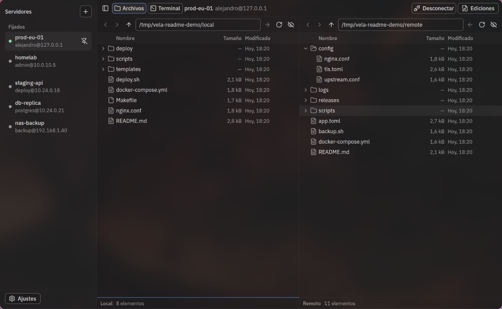
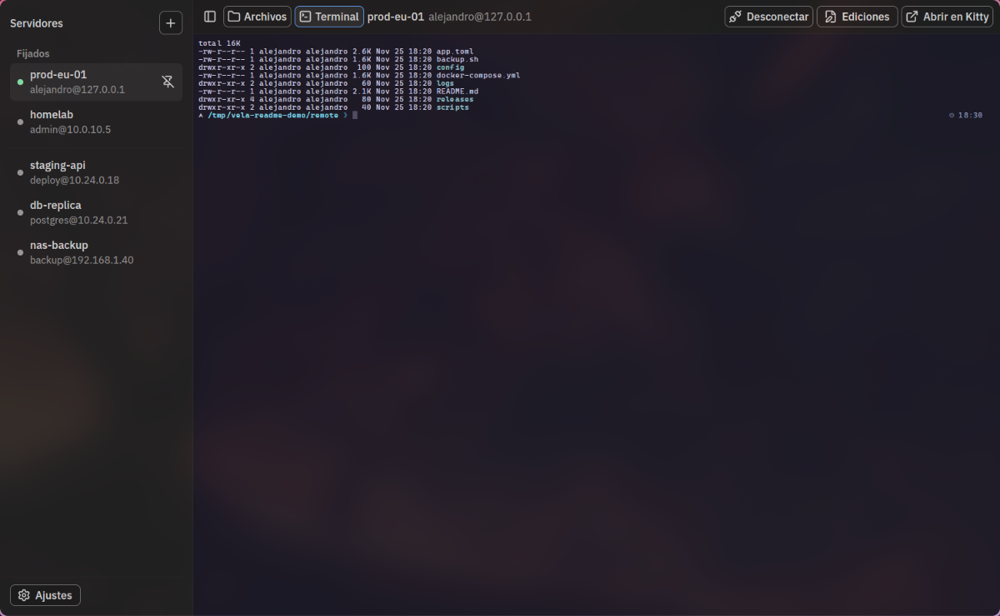
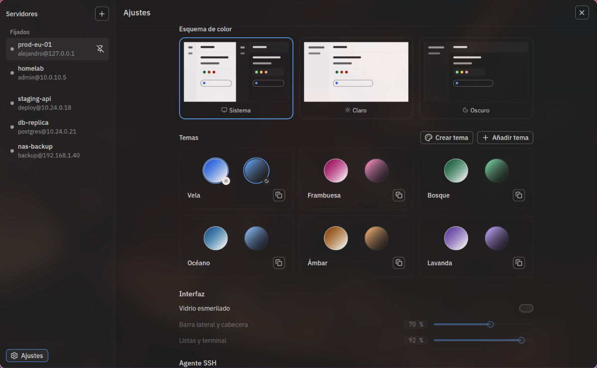

<div align="center">

# Vela

A native SSH and SFTP client for macOS and Linux, written in Rust with GPUI.

[](https://github.com/Alejandro12120/Vela/actions/workflows/ci.yml)
[](https://github.com/Alejandro12120/Vela/releases)
[](LICENSE)

<picture>
  <source media="(prefers-color-scheme: dark)" srcset="docs/screenshots/files-dark.png">
  <source media="(prefers-color-scheme: light)" srcset="docs/screenshots/files-light.png">
  
</picture>

</div>

Vela puts a dual-pane SFTP file manager and an SSH terminal in one native binary. It runs your system `ssh` binary for connections, uses about 50 to 60 MB of RAM at idle on macOS, and opens in 100 to 150 ms.

## What Vela does

- **Dual-pane SFTP browser.** Local files sit on the left and remote files sit on the right. Folders expand in place like Finder inside virtualized lists. Right-click either pane to create a New Folder or New Text File. Dragging inside a pane moves items, and dragging to the opposite pane copies them through a transfer queue.
- **System OpenSSH transport.** Vela honors `~/.ssh/config`, `ProxyJump`, and `known_hosts`. It keeps one `ControlMaster` connection per server, so OpenSSH asks for a password, passphrase, or agent approval once per session.
- **Bitwarden SSH agent and password auth.** The server form lists keys from your Bitwarden SSH agent and passes `IdentitiesOnly=yes` with the chosen public key, so extra keys do not exhaust authentication attempts. Password authentication prompts at connection time and never writes passwords to disk.
- **Remote editing with upload on save.** Double-clicking a remote text file downloads a working copy and opens it in your editor, including VS Code, Cursor, Zed, Sublime Text, or the OS default. When you save, Vela checks the remote file for conflicts and uploads in place, keeping the remote inode, owner, and permissions.
- **Integrated SSH terminal.** Each session has a full-window terminal built on `alacritty_terminal` and GPUI. It reads font settings from `kitty.conf` when available. In Settings → Terminal → Colors, choose Vela theme or kitty.conf. You can also open the active session in Kitty.
- **Desktop integration.** On macOS, you can drag files to and from Finder and copy or paste remote files with Finder. Deleting local files moves them to macOS Trash or freedesktop Trash on Linux.
- **Themes and translucency.** Six built-in themes come with separate light and dark selections, a live color editor with contrast checks, and optional frosted glass.

<table>
  <tr>
    <td width="50%">
      
      <p align="center"><sub>The integrated SSH terminal supports Vela theme colors and kitty.conf colors.</sub></p>
    </td>
    <td width="50%">
      
      <p align="center"><sub>Settings include built-in themes, separate light and dark picks, and frosted glass.</sub></p>
    </td>
  </tr>
</table>

## Install

### Quick install

```sh
curl -fsSL https://raw.githubusercontent.com/Alejandro12120/Vela/main/install.sh | sh
```

The install script detects your OS and CPU architecture, downloads the matching archive from [GitHub Releases](https://github.com/Alejandro12120/Vela/releases), and checks both its Ed25519 signature and SHA-256 checksum before installing.

- **macOS.** On Apple Silicon, the script installs `Vela.app` into `/Applications` with its native app icon so Spotlight and the Dock find it.
- **Linux.** On x86_64 Wayland systems, the script installs the `vela` binary, its `.desktop` file, and its icon so Rofi, Fuzzel, Walker, and other launchers list it.

The installer defaults to the latest stable release. To include prereleases, use `sh -s -- --prerelease` at the end of the command above, or set `VELA_PRERELEASE=1` for the shell running the installer. Prerelease discovery requires Python 3. Use `--version <tag>` to install a specific release.

### Manual install

Download the archive for your system from [Releases](https://github.com/Alejandro12120/Vela/releases).

- **macOS.** Extract `Vela-<version>-macos-aarch64.tar.gz` and move `Vela.app` into `/Applications`.
- **Linux.** Extract `vela-<version>-linux-x86_64.tar.gz`, place `vela` in a directory on your `PATH` such as `~/.local/bin/vela`, and copy `vela.desktop` to `~/.local/share/applications/`.

Every release includes detached `.sig` and `.sshsig` files, `SHA256SUMS.txt`, and a signed `manifest.json`. See [docs/RELEASES.md](docs/RELEASES.md) for manual verification commands.

## Updating

Click the check-for-updates button on the right side of the sidebar footer. When an update is available, hover over the button for the version and a short preview of the release notes. Click the button to review and confirm the update. Vela verifies the signed manifest and release archive, shows installation progress above the footer, and restarts automatically when the update finishes.

**Settings → Updates** shows the installed version. Turn on **Include Prereleases** to check for the highest published version, including release candidates. Vela checks again as soon as you change the setting. Turning it off while running a prerelease offers the latest stable version, even when that version is older.

You can also update by running the install script again or downloading a release by hand.

## Migrating from vSCP

Vela imports the legacy vSCP configuration on startup. It adds servers and trusted hosts, copies missing keys and themes, and fills default settings with legacy preferences. Existing Vela server entries, files, and customized preferences take precedence. The old built-in `vscp` theme becomes `vela`.

Vela carries forward indexed remote-edit copies, including pending changes and conflicts. Close vSCP before migrating and reopen the working copies from Vela afterward. Vela keeps the legacy configuration directory if migration encounters invalid settings or a conflicting working copy.

## Requirements

- **macOS.** Apple Silicon, macOS 14 or newer, and system OpenSSH.
- **Linux.** An x86_64 machine running a Wayland compositor, a Vulkan driver such as `vulkan-intel` or `vulkan-radeon` or Mesa EGL, system OpenSSH, and `xdg-open`.

Vela does not support Windows. On Linux, outbound file drag and file clipboard support for Dolphin are still pending.

## MCP

Open **Settings → Agentes (MCP)** to register Vela with supported clients and manage permission profiles. Use **Acceso MCP…** in a server’s context menu or details header to choose its availability and rules. The global switch and new servers start disabled.

Run `vela mcp` as a stdio MCP server for Vela's SSH and SFTP tools. The CLI also supports `vela mcp status`, `vela mcp install --all` and `vela mcp uninstall --harness <id>`. In builds with the `dev` feature, use temporary directories for `VELA_CONFIG_DIR` and `VELA_MCP_HARNESS_HOME`, then set `VELA_DEV_SETTINGS=mcp` to scroll to the section or `VELA_DEV_MCP_VIEW=harnesses|server:<display name>` to open a dialog at startup. `VELA_DEV_MCP_DIFF=<harness-id>` previews a pending dry-run diff in the installer. See the [MCP setup and integration guide](docs/MCP.md).

## Keyboard shortcuts

<details>
<summary>Show default shortcuts</summary>

| Action | macOS | Linux |
| --- | --- | --- |
| Switch to Files or Terminal | `⌘1`, `⌘2` | `Ctrl+1`, `Ctrl+2` |
| Toggle server sidebar | `⌘S` | `Ctrl+S` |
| Open Settings | `⌘,` | `Ctrl+,` |
| Refresh active pane | `⌘R` | `Ctrl+R` |
| Toggle hidden files | `⌘⇧.` | `Ctrl+Shift+.` |
| Back, forward, and parent folder | `⌘[`, `⌘]`, `⌘↑` | `Ctrl+[`, `Ctrl+]`, `Ctrl+↑` |
| Open selected folder | `⌘↓` | `Ctrl+↓` |
| Copy across panes | `F5` | `F5` |
| Rename selected item | `Enter` | `Enter` |
| Delete selected item | `⌘⌫` | `Delete` |
| Terminal copy, paste, and select all | `⌘C`, `⌘V`, `⌘A` | `Ctrl+Shift+C`, `Ctrl+Shift+V`, `Ctrl+Shift+A` |
| Terminal font size grow, shrink, and reset | `⌘+`, `⌘-`, `⌘0` | `Ctrl+Shift++`, `Ctrl+Shift+-`, `Ctrl+Shift+0` |

</details>

## Build from source

Building from source requires Rust `1.98.1`, pinned in [`rust-toolchain.toml`](rust-toolchain.toml).

<details>
<summary>Show Linux packages and build commands</summary>

On Arch Linux:

```sh
sudo pacman -S --needed base-devel pkgconf wayland libxkbcommon libxkbcommon-x11 \
  vulkan-icd-loader vulkan-headers fontconfig freetype2 openssh libx11 libxcb
```

On Ubuntu or Debian:

```sh
sudo apt-get install -y pkg-config libwayland-dev libxkbcommon-dev libxkbcommon-x11-dev \
  libvulkan-dev libfontconfig1-dev libfreetype-dev libx11-dev libxcb1-dev \
  libxcb-shape0-dev libxcb-xfixes0-dev fontconfig openssh-client openssh-server
```

Build and run the release binary:

```sh
cargo build --release
./target/release/vela
```

</details>

## License

Vela is licensed under the [GNU General Public License v3.0 or later](LICENSE).
